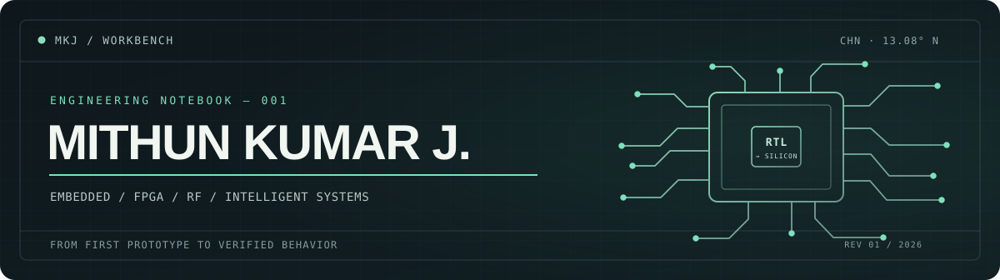

  

  <strong>Electronics & Communication Engineering · VIT Chennai · Class of 2028</strong> 
  I build where circuits meet code — and I care about what survives contact with real hardware.

  <a href="https://www.linkedin.com/in/mithun-kumar-j/">LinkedIn</a>
  &nbsp; / &nbsp;
  <a href="mailto:mithunkumarjagan@gmail.com">Email</a>
  &nbsp; / &nbsp;
  <a href="https://github.com/Mithunjagan?tab=repositories">All repositories</a>

---

### 01 / Selected work

**[LDACS receiver on Zynq-7000](https://github.com/Mithunjagan/LDACS)** `FPGA` `Verilog` `Zynq`  
A hardware/software communications receiver with a Python reference chain, ARM-side processing, FPGA logic, and a real board-to-host UART loopback. Hardware integration validated; specification conformance still under test.

**[DeCad — schematic to editable CAD](https://github.com/Mithunjagan/DeCad)** `EDA` `Python` `KiCad`  
A local workbench for recovering circuits from scanned schematics, reviewing connections, and exporting them to native CAD workflows.

**[2.45 GHz smart-glasses antenna](https://github.com/Mithunjagan/Antenna-for-Smart-Glasses-2.45-GHz-)** `RF` `CST` `Wearables`  
Designed and simulated a 50 × 6 mm printed dipole near a layered head model. **−18.76 dB S11** and **45.5% radiation efficiency** on-head at 2.45 GHz; simulation results, not prototype measurements.

**[Delta modulation on ZedBoard](https://github.com/Mithunjagan/DCS_DM)** `DSP` `FPGA` `Vivado`  
A real-time 1-bit encoder/decoder with switch-controlled step size, reconstructed output, and observable slope overload vs. granular noise.

Also exploring: <a href="https://github.com/Mithunjagan/Dynamic-Partial-Reconfiguration_LDACS">dynamic partial reconfiguration</a> · <a href="https://github.com/Mithunjagan/Project007">computer vision &amp; motion analysis</a> · <a href="https://github.com/Mithunjagan/ESP-antenna">PCB antenna tuning</a>

---

### 02 / On the bench

- **Digital hardware:** RTL design, verification, FPGA architecture, and accelerators.
- **Embedded engineering:** firmware, sensors, buses, control logic, and board bring-up.
- **RF & signal systems:** antenna simulation, communications, and the gap between theory and a measurable result.

**Tools I actually reach for:** `C/C++` · `Python` · `Verilog` · `ESP32` · `STM32` · `Zynq-7000` · `Vivado` · `KiCad` · `CST` · `Git`

---

### 03 / What I'm looking for

Embedded systems, firmware, FPGA / RTL, and hardware R&D internships — plus paid engineering collaborations where I can contribute to something real.

If you're building something that needs both a schematic and a debugger, [let's talk](mailto:mithunkumarjagan@gmail.com).

Less "passionate about technology." More schematics, source code, measurements, and lessons learned.
