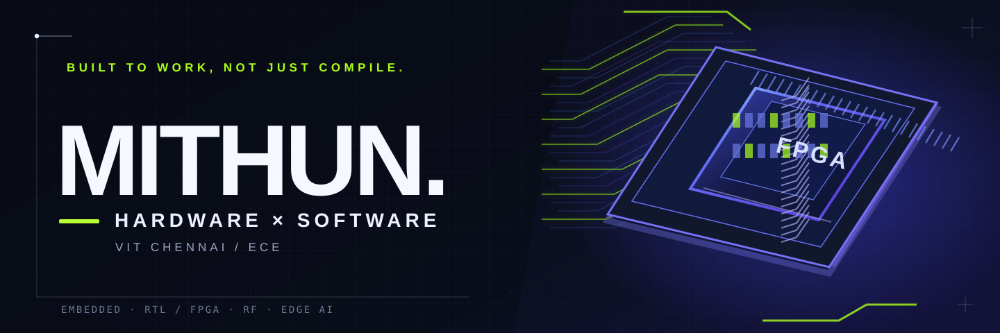

 

**ECE @ VIT Chennai** &nbsp;·&nbsp; **Embedded systems** &nbsp;·&nbsp; **RTL / FPGA** &nbsp;·&nbsp; **RF engineering**

[LinkedIn](https://www.linkedin.com/in/mithun-kumar-j/) &nbsp;·&nbsp; [Email](mailto:mithunkumarjagan@gmail.com) &nbsp;·&nbsp; [Explore repositories](https://github.com/Mithunjagan?tab=repositories)

---

I'm Mithun, an electronics and communication engineering student who likes getting **hardware and software to work together outside a simulation**. I work across firmware, FPGA design, communications, RF, and practical tooling.

### Projects / built, measured, debugged

<table>
<tr>
<td width="50%" valign="top">

**[DeCad →](https://github.com/Mithunjagan/DeCad)**

*From scanned schematic to editable circuit.*

Local EDA workbench for reviewing components, tracing nets, and working with native CAD files.

`Python` &nbsp; `KiCad` &nbsp; `EDA`

</td>
<td width="50%" valign="top">

**[2.45 GHz smart-glasses antenna →](https://github.com/Mithunjagan/Antenna-for-Smart-Glasses-2.45-GHz-)**

*Wearable RF design, tested against a head model.*

50 × 6 mm printed dipole · **−18.76 dB S11** · **45.5% on-head radiation efficiency**. Simulation results.

`CST` &nbsp; `RF` &nbsp; `Wearables`

</td>
</tr>
</table>

<table>
<tr>
<td width="50%" valign="top">

**[LDACS receiver on Zynq-7000 →](https://github.com/Mithunjagan/LDACS)**

FPGA + ARM receiver pipeline with real board/host UART loopback. Hardware integration validated; independent standard-conformance testing remains open.

`Verilog` &nbsp; `Zynq` &nbsp; `Python`

</td>
<td width="50%" valign="top">

**[Delta modulation on ZedBoard →](https://github.com/Mithunjagan/DCS_DM)**

1-bit encoder/decoder on hardware, with switch-controlled step size and ILA traces showing slope overload and granular noise.

`FPGA` &nbsp; `Vivado` &nbsp; `DSP`

</td>
</tr>
</table>

**More from the lab:** [Dynamic partial reconfiguration](https://github.com/Mithunjagan/Dynamic-Partial-Reconfiguration_LDACS) · [Motion analysis / Project 007](https://github.com/Mithunjagan/Project007) · [PCB antenna tuning](https://github.com/Mithunjagan/ESP-antenna)

---

### Currently on the workbench

**RTL & verification** / from testbenches to FPGA architecture and, eventually, ASIC design.

**Embedded engineering** / C/C++, STM32, ESP32, Raspberry Pi, sensors, protocols, and board bring-up.

**Tools** / Verilog, Python, Vivado, KiCad, CST, Git, Linux.

### Want to build something?

I'm open to **embedded / firmware / FPGA / hardware R&D internships** and **paid engineering projects**. If there's real hardware to debug, I'm interested.

**[Get in touch →](mailto:mithunkumarjagan@gmail.com)**

